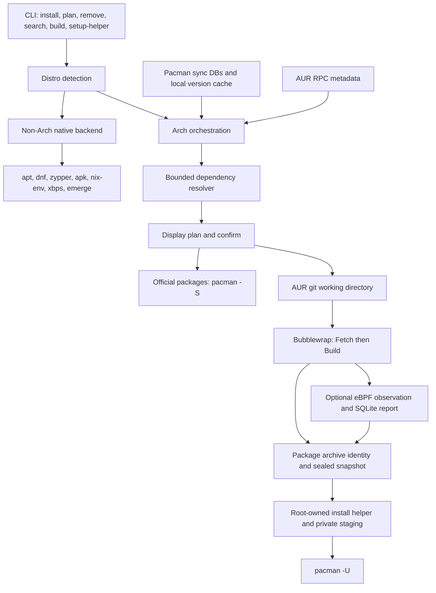

# Archon architecture and production readiness

Reviewed 2026-10-27 at commit `0672571`, workspace version 0.2.1.

This is the baseline review before the subsequent lifecycle implementation.
The product direction is deep support across distro families, with isolated
adapters. [CROSS-DISTRO.md](CROSS-DISTRO.md) describes the implemented follow-up,
current capability matrix and remaining depth milestones. Statements below
about absent lifecycle commands describe the reviewed baseline.

## Assessment

Archon implements Fedora support through native DNF delegation. It implements
eight distro-family paths in total. Its deeper package resolution, AUR build,
sandbox, and optional eBPF pipeline are Arch-specific.

The current code is an experimental package-management frontend with an Arch
build pipeline. It is not ready to be the sole package-management interface
shipped by a production OS. The most significant gaps are privileged filesystem
handling, monitor completeness, authoritative transaction planning, system
upgrades, recovery across multiple transactions, and real distro verification.
This assessment distinguishes source observations from tested behavior; it is
not an exploit audit or a certification.

## Distro support

Detection reads `/etc/os-release` (or `ARCHON_OS_RELEASE`), honors a recognized
`ID` first, then examines `ID_LIKE` in its declared order.

| Family | Install/remove executor | Scope |
|---|---|---|
| Arch and derivatives declaring `arch` | pacman | Custom resolver, official repositories, AUR builds, sandbox, optional monitoring |
| Fedora/RHEL and derivatives declaring `fedora` or `rhel` | dnf | Native install/remove/search delegation |
| Debian/Ubuntu and derivatives | apt / apt-cache | Native install/remove/search delegation |
| openSUSE/SLE | zypper | Native install/remove/search delegation |
| Alpine | apk | Native install/remove/search delegation |
| NixOS | nix-env | User-profile operations; no sudo; not declarative OS configuration |
| Void | xbps-install / xbps-remove / xbps-query | Native delegation |
| Gentoo | emerge | Native delegation; removal uses depclean semantics |

Fedora examples map to `sudo dnf install firefox`, `sudo dnf remove firefox`,
and `dnf search firefox`. `--yes` adds `-y` for install/remove. The native
manager owns resolution, signatures, locking, scripts, and transaction execution.
Archon's `plan`/`--dry-run` off Arch prints the command without asking the
backend to solve a transaction. It therefore does not establish installability,
dependency changes, removals, download sizes, or signature validity.

`install --report` explicitly rejects non-Arch systems. Local `build` still
requires makepkg and its Arch toolchain; it does not provide an RPM/SRPM or DEB
build backend. AUR support does not make Arch packages portable to Fedora.

Important boundaries:

- Family detection alone cannot identify the host's deployment model. An
  rpm-ostree host needs deployment/layering operations, not ordinary DNF host
  installation. Current detection has no such capability check.
- Nix support assumes the `nixos` channel attribute prefix. Its operations are
  profile changes, not `nixos-rebuild` configuration changes.
- RHEL derivatives need an available/configured DNF installation and usable
  repositories; recognizing their family does not establish those prerequisites.
- There is no declared CPU/kernel compatibility matrix. The committed monitor
  object targets `bpfel-unknown-none`; source has fixed tracepoint offsets.
- Unknown distro families fail explicitly. No Flatpak, Snap, rpm-ostree, or
  bootc backend is implemented.

Sources: [detection](../crates/archon-distro/src/lib.rs),
[backends](../crates/archon-distro/src/backend.rs),
[dispatch](../crates/archon/src/commands/install.rs).
The upstream [rpm-ostree administrator handbook](https://coreos.github.io/rpm-ostree/administrator-handbook/)
documents deployment and layering semantics. The
[DNF5 migration documentation](https://dnf5.readthedocs.io/en/latest/changes_from_dnf4.7.html)
documents CLI differences that should be represented in compatibility tests.

## Current architecture



The ordinary build path bypasses the optional monitor node. The monitored path
checks its report before archive installation. Official packages are installed
before AUR builds; AUR bases are then built and installed in dependency order.
This is several native transactions, not a single atomic operation.

| Crate/module | Responsibility | Boundary |
|---|---|---|
| archon-types | Package metadata, dependencies, ALPM/Dpkg version semantics, provider interface | No complete distro transaction model |
| archon-repo | Pacman sync/local DB readers, parsed JSON caches, experimental AptLists parser | Reads metadata; never writes native package DBs |
| archon-aur | AUR RPC client, search, recipe-base metadata and clone URLs | Network metadata is not executable recipe verification |
| archon-resolver | Providers, constraints, conflicts, alternatives, bounded backtracking, build order | Installed package names are preference hints, not a complete installed-state model |
| archon-distro | Distro detection and native command argument construction | Does not solve or execute transactions itself |
| archon-sandbox | Bubblewrap policy, two-stage makepkg runner, privilege drop and cgroup join | Host toolchain is exposed read-only; not a hermetic build image |
| archon-monitor-common | Event ABI shared with eBPF | Fixed-size event fields |
| archon-monitor | Aya loader, event policy, SQLite event store, reports | Observes selected syscall entry events |
| archon-monitor-ebpf | execve/openat/IPv4 connect probes | Separate workspace/toolchain; prebuilt object embedded in CLI |
| archon-cli | Commands, prompts, orchestration, archive snapshots, privileged helper protocol | Owns the operational workflow and most privilege-sensitive coordination |

There are nine normal workspace members, plus the separate eBPF workspace.
The experimental Debian parser is not used by the non-Arch install path.

Useful existing design decisions include native ownership of package DB writes,
shell-free argument execution, typed resolver failures, bounded search, split
package grouping, unprivileged build execution, network isolation in Build,
sealed archive snapshots, bounded helper input, private staging, and refusal to
install when a requested monitor captures zero events or flags violations.

## Production blockers

### 1. Reduce the privileged surface before expanding features

The `--report` workflow runs the main process as root and drops privileges for
the sandbox child. Before that child runs, root performs git operations,
creates paths under the user's home, changes ownership, and opens a SQLite DB
under the user-controlled build tree. `ensure_owned_impl` shells out to chown
on those paths without the component protections used by the install helper.

This is a high-risk trust boundary: pre-existing symlinks and concurrent path
replacement need adversarial tests. This review did not execute a privileged
exploit. Treat it as a release blocker until those paths are removed from the
privileged parent or independently shown safe.

Keep CLI, network access, cloning, metadata parsing, caches, and builds under an
unprivileged identity. Give monitoring a narrowly scoped privileged service or
helper. Retain a separate minimal installer. Use administrator-owned state and
descriptor-based path operations where privileged access is unavoidable.

Sources: `commands/install.rs:698`, `commands/install.rs:1074`,
`commands/build.rs`, and `archon-monitor/src/store.rs`.

### 2. A clean monitoring report does not establish complete observation

The eBPF ring-buffer reservation failure simply returns. Despite its comment,
there is no dropped-event counter in `BuildReport`; `is_clean` checks only that
some events were captured and none were flagged. Partial observation can thus
meet the current clean-report condition.

The probes cover only execve, openat, and IPv4 connect. They do not cover every
execution, filesystem mutation, or network operation. The path policy uses a
lexical prefix without resolving cwd, openat directory descriptors, symlinks,
or parent traversal. Empty path reads are accepted without a violation. Tool
allowlisting by basename and declared-source IPs are heuristics, not package
trust decisions. Fetch runs recipe code with network access; Build's network
namespace does not restrict Fetch.

Add explicit observation-health status, loss/read-error counters, compatible
kernel/architecture checks, and fail-closed handling for incomplete capture.
Test buffer saturation and bypass cases on real kernels. Use sandbox isolation
as the enforcement boundary and describe the report as evidence about captured
behavior, not proof that package contents or future install scripts are safe.

Sources: `archon-monitor-ebpf/src/main.rs:149,199`,
`archon-monitor/src/policy.rs:198`, `archon-monitor/src/report.rs:21`.

### 3. Make the displayed plan match the native transaction

The CLI supplies hardcoded `core`, `extra`, `multilib` precedence rather than
reading the effective pacman configuration. Other on-disk DBs are appended
alphabetically, even though on-disk presence does not establish enablement.
The local DB retains names and versions, not all installed relationships.
Official execution passes package names to pacman, which resolves again.

Consequently, the custom plan is advisory: it does not capture all effects on
installed packages, repository policy, removals, replacements, hooks, or
changes between planning and execution. Non-Arch planning is only argv output.

For an Arch-based OS, use libalpm or a native transaction adapter to prepare an
authoritative plan, then revalidate it at commit. Model removals, replacements,
install reasons, provenance, versions, and configuration changes explicitly.
Define plan invalidation and reconfirmation when state changes.

Sources: `archon-repo/src/lib.rs:28`, `archon-repo/src/local_db.rs`,
`archon-resolver/src/plan.rs`, `commands/install.rs:471`.

### 4. Bind recipe and artifact identity to the selected plan

Existing AUR clones are reused without fetching or checking the selected
revision. RPC metadata, the actual PKGBUILD, and output versions can diverge.
Archive lookup checks the package name through pacman, but does not compare the
output version with the planned version. VCS packages require an explicit
version policy rather than naive equality checks.

Use isolated per-build workspaces, explicit commit/review policy, source and
artifact digests, sandboxed metadata verification, and output relationship /
architecture validation. Keep user edits separate from managed build caches.
Read-only host root exposure also needs a secret/socket exposure review and
replacement with a minimal build root for stronger isolation and reproducibility.

Sources: `commands/install.rs:511,956`, `archon-sandbox/src/policy.rs`.

### 5. Supply the OS maintenance lifecycle

The CLI currently has install, plan, remove, build, search, and setup-helper.
It has no system upgrade, refresh, reinstall, downgrade, repair, repository
management, or package verification interface. Native tools still provide
parts of that lifecycle, but Archon cannot yet be an OS's complete user-facing
package interface. System upgrade policy must preserve the native distro's
consistency requirements.

The official install and each AUR base commit separately. A later failure leaves
earlier changes installed. There is no durable workflow journal to distinguish
completed, failed, and pending steps or guide restart after a crash. SQLite
monitor events are not such a journal. Define resume and recovery behavior;
offer rollback only where the OS storage/deployment model supports it.

Sources: `archon/src/main.rs:31`, `commands/install.rs:270`,
`commands/install.rs:601`.

### 6. Bound resources and concurrent work

Build stdout/stderr is collected with unbounded `read_to_end`; there is no build
time/CPU/memory/process/disk policy. A cgroup used for observation does not by
itself impose resource limits. Builds share cache directories, and cache
writes use a predictable `.tmp` filename. Cache fingerprints use second-level
mtime, so cache correctness/concurrency should be revisited.

Add bounded persistent logs, timeouts, cancellation and process-tree cleanup,
resource limits, per-base locks, unique atomic cache writes, and transaction
preflight checks before the first system mutation.

Sources: `commands/subprocess.rs`, `archon-repo/src/cache.rs`,
`commands/install.rs:785`, `archon-sandbox/src/runner.rs`.

### 7. Establish release evidence

No CI workflow directory is present. The supplied container matrix covers Arch,
Ubuntu, Debian, Fedora, openSUSE, and Alpine; it omits NixOS, Void, and Gentoo,
and several advertised derivative families. Images mostly use floating tags.
Smoke mode does not prove transactions; install mode exercises only jq.
The matrix does not exercise the AUR helper, privileged monitor, or boot recovery.

Use pinned images for userspace tests and disposable VMs for privileged kernel,
SELinux, signature, crash/reboot, and upgrade tests. Test denied/invalid/missing
signatures as well as successful installs, native lock contention, repo outages,
disk exhaustion, interrupts, split packages, stale plans, and monitor event loss.
Automate eBPF source/object correspondence, dependency review, release signing,
SBOM generation, native package distribution, and helper upgrades.

Sources: `scripts/matrix.sh`, `scripts/matrix.Dockerfile`,
`scripts/matrix-scenarios.sh`, `AUDIT.md`.

## Recommended architecture and implementation order

The intended product supports multiple OS bases through independently developed
adapters, starting with deeper Fedora integration alongside the existing Arch
pipeline. Each native engine should remain authoritative for its own planning
and maintenance. An independent
package engine additionally needs a package format, signed repository metadata,
file ownership database, extraction and hook rules, and an upgrade/recovery
design; those are a substantially different project.

Recommended layers:

1. Unprivileged CLI and API with structured errors and machine-readable output.
2. Host capability discovery: distro/version, deployment model, native tool
   version, root/profile scope, kernel and sandbox capabilities.
3. Transaction service: authoritative native plan, state validation, durable
   progress journal, confirmation, execution, cancellation, and recovery.
4. Capability-based native adapters for plan/commit/query/upgrade/verify, with
   unsupported operations explicit rather than guessed from distro family.
5. Separate unprivileged build service with minimal immutable build roots,
   source/recipe pinning, artifact validation, and resource limits.
6. Narrow privileged monitor and installation services with administrator-owned
   state and bounded protocols.
7. Repository and release infrastructure owned by the OS project: signatures,
   trust/key rotation, staged updates, reproducibility, and recovery media.

Execution order: first close privileged-path and monitoring-health blockers;
then implement authoritative transactions and the maintenance lifecycle through
isolated adapters; establish VM/CI release gates for every supported family as
its depth grows.
Do not reimplement RPM and dpkg resolution simply to obtain a uniform CLI.

## Verification performed in this review

On the current Arch host:

```sh
cargo test --locked --offline \
  -p archon-distro -p archon-resolver -p archon-types -p archon-repo \
  -p archon-sandbox -p archon-monitor -p archon-monitor-common
```

Result: **157 unit tests passed**, no failures; associated doc tests passed.
Breakdown: distro 27, resolver 40, types 29, repo 26, sandbox 14, monitor 17,
monitor-common 4.

Selected existing CLI tests were run using these filters:

```sh
for filter in delegat install_yes_on_fedora install_dry_run_on_nixos \
  install_on_unsupported install_report_on_non_arch package_names_starting; do
  cargo test --locked --offline -p archon-cli --test cli "$filter" || exit
done
```

Result: **10 CLI tests passed**, no failures. These establish fixture-driven
delegation, expected command construction, and rejection behavior. They do not
run DNF or establish Fedora transaction success. Docker and Podman are absent,
so a real distro matrix was not run. No host package transaction or privileged
eBPF run was performed. The complete workspace suite was not rerun here.
Existing historical results in `AUDIT.md` remain separate evidence.

No runtime code was changed by the baseline review; subsequent implementation
is documented in CROSS-DISTRO.md.
